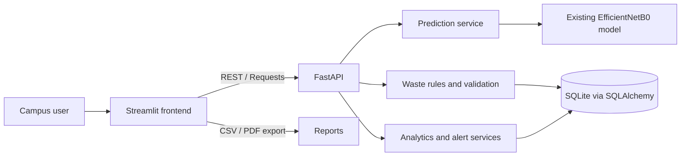

# Smart Waste Segregation and Recycling Monitoring System

CSE472 project for recording campus waste classifications, recommending disposal streams, and monitoring user-reported segregation decisions across Hostel, Canteen, Academic Block, and Library locations.

## Problem and objectives

Waste streams are often mixed because people lack clear disposal guidance and institutions have little structured information about reported segregation practices. This application uses the project's existing EfficientNetB0 model to classify uploaded images, recommends a configurable collection stream, stores user-confirmed records, and summarizes those records for campus review.

## Technology

- Streamlit, Python, Plotly, Pandas
- FastAPI, Pydantic, Uvicorn
- Existing TensorFlow/Keras EfficientNetB0 model
- Pillow and NumPy image processing
- SQLAlchemy ORM and SQLite
- Requests for frontend-to-backend REST calls; ReportLab for PDF reports

## Architecture



## Workflow

1. The user uploads a JPG, PNG, or WEBP image (up to 10 MB).
2. FastAPI resizes it to 224 × 224 RGB and normalizes pixel values to [0,1].
3. The existing model predicts one of nine configured categories and returns confidence and disposal guidance.
4. The user selects a campus location and the bin actually used, then confirms saving.
5. SQLite stores the record. Compliance is calculated by comparing the selected bin with the category's configured recommended bin.
6. The frontend retrieves records, analytics, alerts, and report data through the API.

## AI model

- Architecture: EfficientNetB0, fine-tuned model supplied with this project at `backend/models/best_efficientnetb0_finetuned.keras`.
- Input: 224 × 224 × 3 RGB.
- Classes: battery, cardboard, glass, metal, organic, paper, plastic, textile, trash.
- Reported held-out evaluation from the supplied project brief: test accuracy 95.83%, test loss 0.1418. These values were not re-evaluated during this implementation.
- Preprocessing was inspected in the saved Keras config: it contains a `Rescaling(scale=255)` layer. The API retains the original normalization to [0,1] before inference.
- The model is loaded lazily on the first valid prediction request. It is never retrained or replaced.

Disposal mappings live in `backend/config.py`. Textile acceptance, contaminated materials, and local recycling rules should be adjusted to campus policy.

## Database

`backend/waste_management.db` contains the `waste_records` table. Existing rows are preserved. On startup the application creates missing tables and adds optional `image_filename`, `notes`, and `weight_kg` columns to older databases without dropping data. Confidence and non-negative manually supplied weight are constrained by the ORM. Indexes support timestamps and location/category filtering.

Compliance is `(correctly segregated records / all records) × 100`. Empty datasets report 0%. Optional weight is only user-entered; image-based weight estimation is not implemented.

## API

Run the API at `http://127.0.0.1:8000`; interactive OpenAPI docs are at `/docs`.

| Method | Endpoint | Purpose |
|---|---|---|
| GET | `/` | Health status |
| POST | `/predict` | Multipart image prediction |
| POST | `/records` | Validate and save a record |
| GET | `/records` | Search/filter/paginate records |
| GET | `/records/{record_id}` | Retrieve a record |
| PUT | `/records/{record_id}` | Edit location, selected bin, notes, or weight; recalculate compliance |
| DELETE | `/records/{record_id}` | Delete a record |
| GET | `/analytics/summary` | Overall counts, category/type distribution, compliance, confidence |
| GET | `/analytics/locations` | Location-wise totals and compliance |
| GET | `/analytics/categories` | Category and waste-type distribution |
| GET | `/analytics/trends` | Daily recording trend |
| GET | `/alerts` | Rule-based alerts derived from records |

Record and analytics endpoints accept optional `start`, `end`, `location`, and `category` filters where applicable. Records additionally accept `status`, `search`, `limit`, and `offset`.

## Frontend pages

- **Dashboard:** date filtering, KPIs, category donut, location bars, compliance comparison, type distribution, and daily trend.
- **AI classification:** image preview, prediction, guidance, location/bin confirmation, optional measured weight, and explicit save.
- **Waste records:** search, filters, details, edit, and confirmed deletion.
- **Analytics:** location performance, category distribution, trends, and highest/lowest observed compliance.
- **Reports:** date/location/category filtered CSV and PDF exports.
- **Alerts and monitoring:** low-compliance warnings (below 70%), repeated recorded issues, and categories needing review.

All charts and alerts come from database records. Empty datasets show an empty state. These records represent user-reported events, not independently verified physical disposal. The project has no IoT sensors or live bin monitoring.

## Windows / VS Code setup

Open the `Smart-Waste-Management` folder in VS Code. Use the existing `.venv` when present. Install declared dependencies:

```powershell
.\.venv\Scripts\python.exe -m pip install -r requirements.txt
```

Start both services in separate terminal windows with:

```powershell
.\run_app.bat
```

Or run them separately:

```powershell
.\.venv\Scripts\python.exe -m uvicorn backend.app:app --reload
.\.venv\Scripts\python.exe -m streamlit run frontend\app.py
```

The dashboard opens at `http://localhost:8501`; FastAPI is at `http://127.0.0.1:8000`. Configure `WASTE_API_URL` if the API uses a different address. `DATABASE_URL` can override the database location. `.env.example` documents these options.

## Testing and API smoke checks

Tests use a temporary SQLite database and do not alter `backend/waste_management.db`:

```powershell
.\.venv\Scripts\python.exe -m pytest tests\test_api.py -p no:cacheprovider
```

Prediction request example:

```powershell
curl.exe -F "file=@plastic.jpg" http://127.0.0.1:8000/predict
```

## Known limitations and future work

- AI classifications can be wrong; users should review the recommendation and local policy.
- A recorded bin choice is self-reported and does not prove physical disposal.
- Trends count recorded events, not waste mass. Weight is optional manual input.
- Alert thresholds are simple configurable rules, not a live sensor feed.
- Future work could add an auditable staff review workflow, institution-specific recycling policies, model evaluation by campus conditions, and trusted scale or bin-sensor integrations.

